# JAB LEATHER — Sialkot Heritage Atelier & Fullstack E-Commerce Engine

<div align="center">

[](https://react.dev/)
[](https://vitejs.dev/)
[](https://tailwindcss.com/)
[](https://supabase.com/)
[](https://nodejs.org/)
[](https://expressjs.com/)
[](https://vitest.dev/)
[](https://playwright.dev/)
[](https://oxc.rs/)

**Handcrafted full-grain leather jackets, riding cuts, travel bags, and bespoke luxury goods from Sialkot, Pakistan.**  
*A custom-built, production-grade e-commerce platform paired with an executive Shopify-style administrative management suite.*

[Storefront Tour](#-storefront-experience) • [Admin Suite](#-shopify-style-admin-operations) • [Architecture](#%EF%B8%8F-system-architecture) • [Security & RLS](#-security--data-protection) • [Local Setup](#-developer-quickstart)

</div>

---

## 📸 Visual Showcase

### Storefront Experience

| Homepage Hero & Atelier Identity | 14-Category Dynamic Mega Menu |
| :---: | :---: |
| 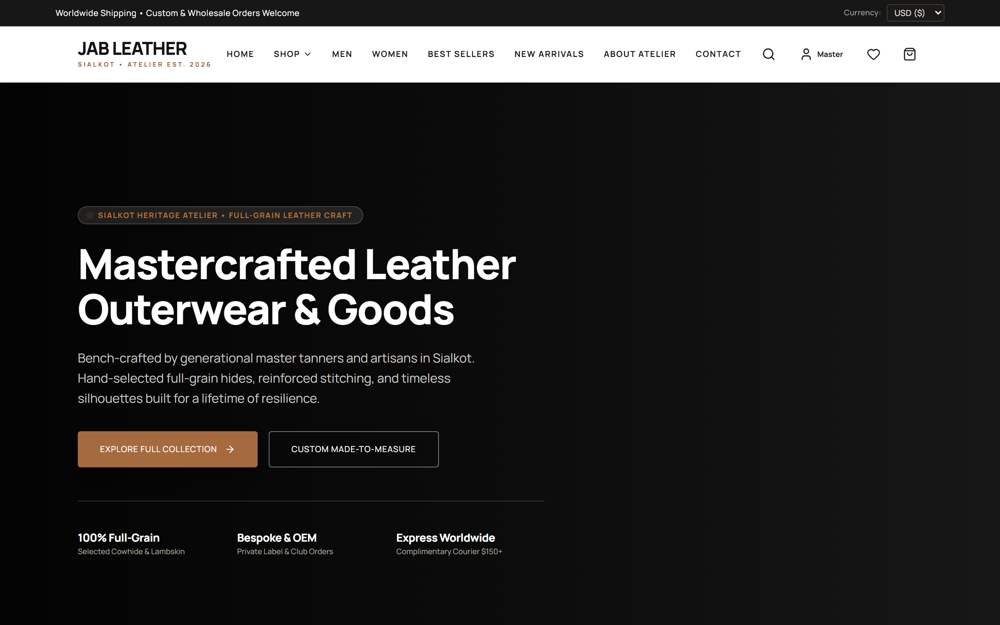 | 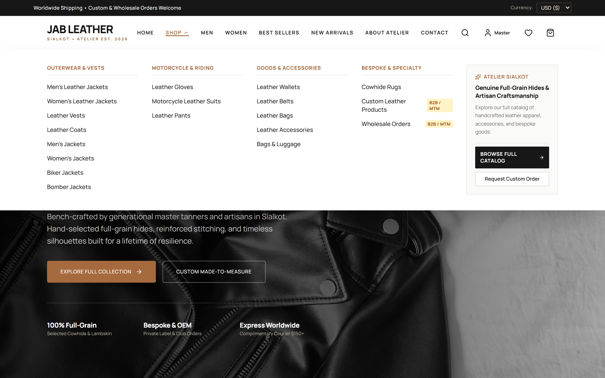 |
| *Editorial luxury hero with artisan heritage badges & currency switcher* | *Departmental navigation spanning outerwear, motorcycle, accessories & bespoke* |

| Catalog Browse & Instant Filtering | Product Detail Page (PDP) |
| :---: | :---: |
| 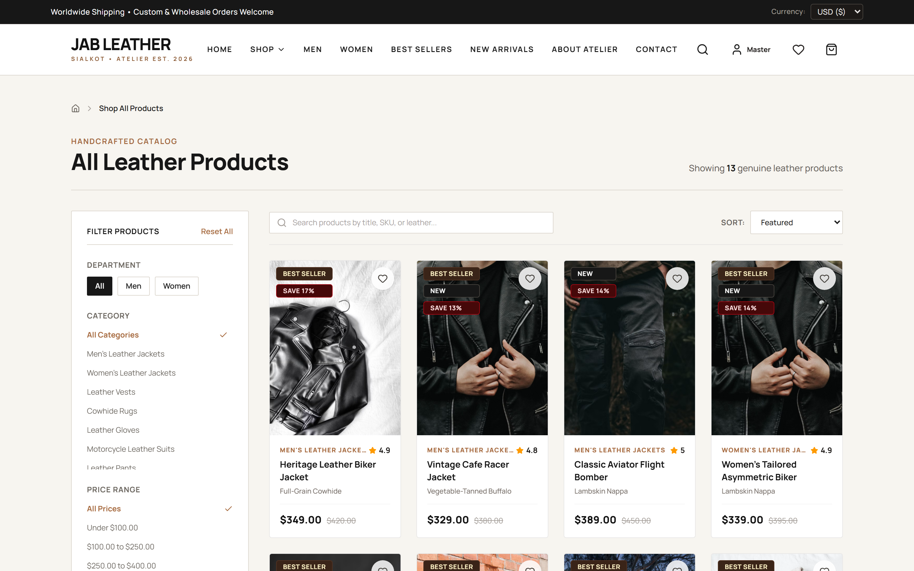 | 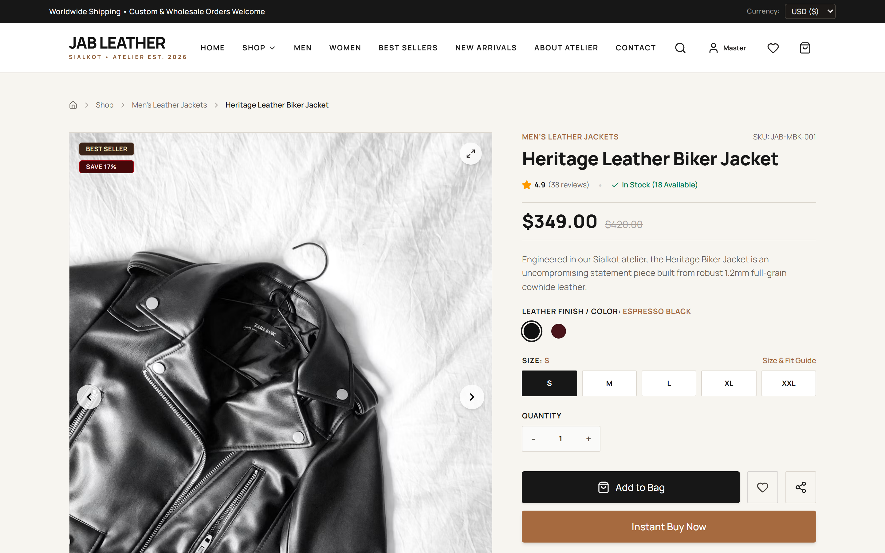 |
| *Search, department filters, sorting, and responsive leather product cards* | *High-res zoom gallery, size selection, color swatches & instant checkout* |

---

### ⚙️ Shopify-Style Admin Operations

| Executive Operations Dashboard | Product Catalog Management |
| :---: | :---: |
| 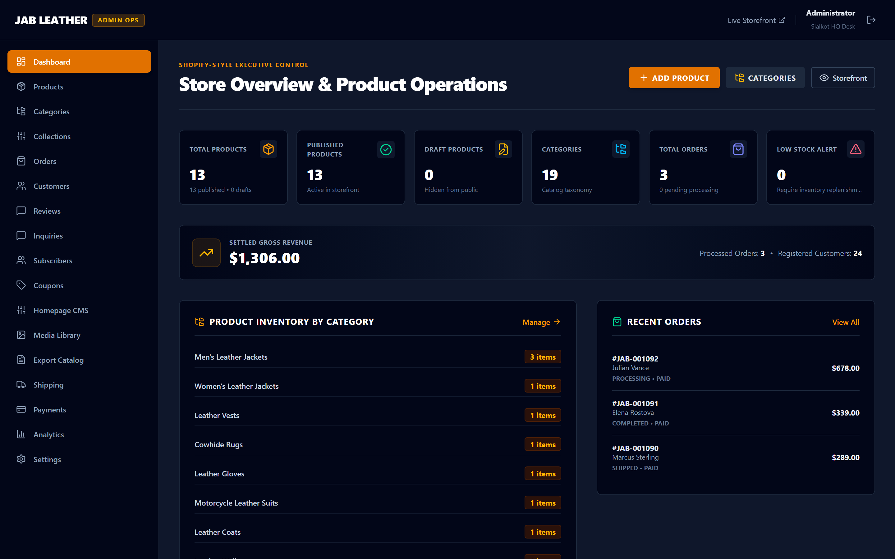 | 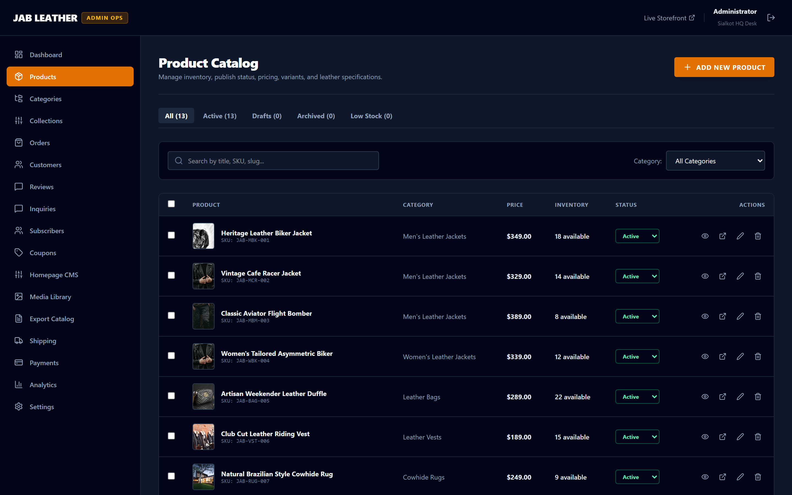 |
| *Gross revenue ticker, inventory alerts, recent orders & category distribution* | *Multi-select batch controls, publish toggles, stock counts & search filters* |

| 8-Section Comprehensive Product Editor | Variant Matrix & Google SERP Snippet Preview |
| :---: | :---: |
| 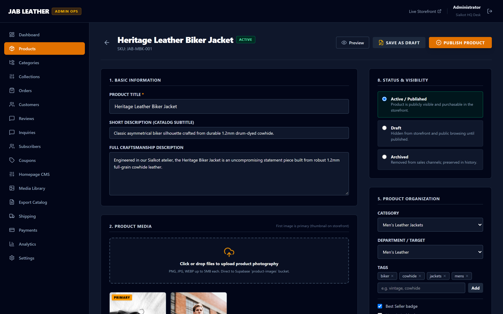 | 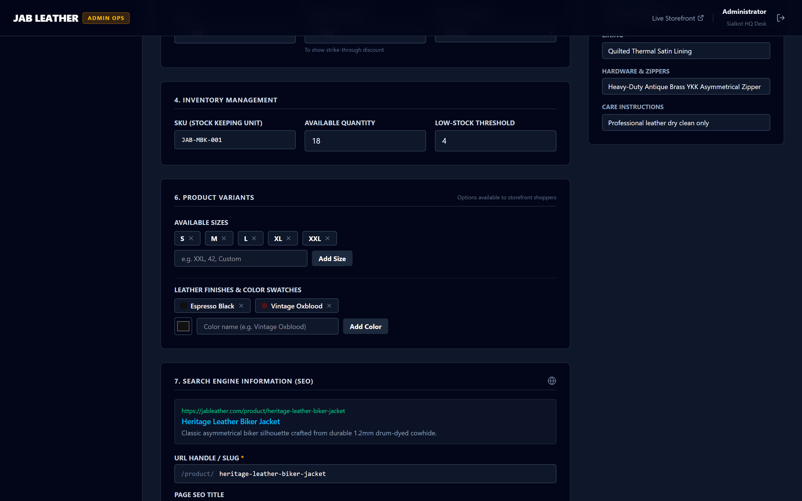 |
| *Clean two-column layout for title, media, pricing, and organizational tags* | *Interactive size/hex color swatches & live Google search result simulation* |

| Dynamic Category & Taxonomy Architecture | Responsive Mobile Shopper Experience |
| :---: | :---: |
| 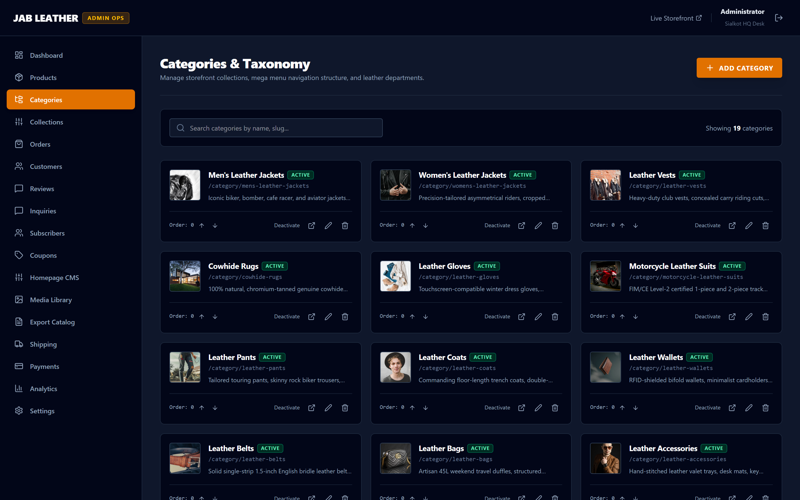 | 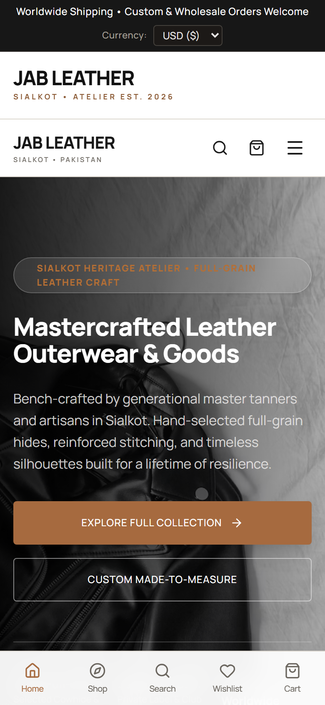 |
| *Real-time category sorting, status activation, and mega menu controls* | *Touch-optimized mobile layout with sticky bottom navigation and cart counters* |

---

## 🌟 The JAB LEATHER Atelier Story

Founded at the epicenter of world-renowned leather tanning and sports manufacturing in **Sialkot, Pakistan**, **JAB LEATHER** bridges generational leather craftsmanship with modern digital commerce. Every garment and accessory is cut from hand-selected hides:

- **Full-Grain Drum-Dyed Cowhide (1.1mm – 1.3mm)**: High-abrasion durability engineered for road touring and heritage cafe racer jackets.
- **Buttery Lambskin Nappa (0.7mm – 0.9mm)**: Feather-soft, lightweight luxury tailored for asymmetric biker jackets and runway outerwear.
- **Vegetable-Tanned Buffalo Hides**: Naturally aged hides with distinct character, custom-dyed for duffles, club vests, and heavy-duty belts.
- **Hardware & Trims**: Heavy-duty antique brass YKK zips, reinforced polyester bonded thread (Tex 70), quilted thermal satin linings, and CE-certified internal armor pockets.

This platform was built from scratch to provide international retail shoppers and B2B custom clients with an effortless buying experience, backed by an operator-friendly administrative system.

---

## 🧭 Key Features & Capabilities

### 🛍️ Shopper Experience
- **14-Category Leather Taxonomy**: Dedicated collections for Men's Jackets, Women's Jackets, Leather Vests, Cowhide Rugs, Gloves, Motorcycle Suits, Pants, Coats, Wallets, Belts, Bags, Accessories, Custom Made-to-Measure, and Wholesale.
- **Dynamic Mega Menu**: Grouped into logical departments (Outerwear, Motorcycle & Riding, Goods & Accessories, Bespoke & Specialty) rendered directly from database settings.
- **Unified Storefront Currency Engine**: Single source of truth with real-time conversion between USD ($) and PKR (₨), preventing mixed-currency carts and accurately computing free shipping thresholds.
- **Interactive Product Detail Experience**: Multi-angle image carousels, size selection with fit guides, genuine hex color swatch pickers, real-time inventory checks, and direct "Add to Bag" / "Instant Buy Now" options.
- **Customer Account & Security**: Strict customer authentication via Supabase Auth. Guest shopping is supported, while personal wishlists and carts are strictly scoped to verified user sessions.
- **Responsive Mobile First**: Polished mobile navigation drawer, bottom tab bar (Home, Shop, Search, Wishlist, Bag), and fast image loading.

### 🛡️ Shopify-Style Admin Suite (`/admin`)
- **Executive Operations KPI Dashboard**: Real-time snapshot of gross settled revenue, active product count, low-stock alerts, category breakdown, and a live timeline of recent order activities.
- **Comprehensive Product Catalog Table**: Status tabs (`All`, `Active`, `Drafts`, `Archived`, `Low Stock`), instant search by title/SKU, category filtering, multi-item batch selection, bulk status actions, and one-click quick previews.
- **8-Section Modular Product Editor**:
  1. *Basic Information*: Product title, catalog subtitle, and full craftsmanship description.
  2. *Product Media*: Primary thumbnail designation and multi-image upload pipeline.
  3. *Pricing*: Base retail price, compare-at strike-through pricing, and store currency.
  4. *Inventory Control*: SKU generator, warehouse quantity, and automated low-stock threshold triggers.
  5. *Product Organization*: Primary category assignment, department targeting, and tag tokens.
  6. *Product Variants*: Matrix builder supporting custom sizes and leather color swatches with integrated hex color pickers.
  7. *Live Google SERP Snippet Preview*: Real-time search engine preview simulating Google's exact mobile/desktop results card with editable meta titles and descriptions.
  8. *Status & Visibility*: Active, Draft, or Archived lifecycle toggles with immediate storefront sync.
- **Dynamic Category Manager**: Admin-controlled taxonomy allowing one-click reordering, department grouping, URL slug customization, and activation/deactivation without code deployments.
- **Payment & Order Processing**: Full audit logs, manual payment confirmation (Bank Wire / Cash on Delivery), and transactional order status transitions.

---

## 🏛️ System Architecture

The JAB LEATHER platform is engineered around a modern, decoupled **3-Tier Jamstack-Hybrid Architecture** that strictly segregates client-side presentation, API orchestration, and cryptographic database persistence. It guarantees sub-50ms catalog responses, atomic stock concurrency, zero-trust client price isolation, and resilient multi-gateway payment processing.

---

### 1. High-Level System Topology

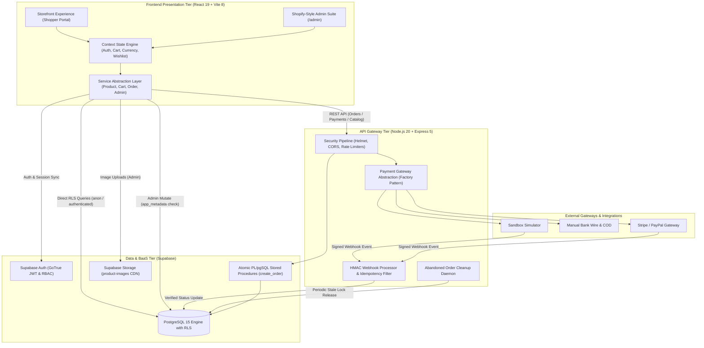

---

### 2. Tier-by-Tier Architectural Breakdown

#### 🖥️ Presentation & Client Tier (`client/`)
- **React 19 & Vite 8 SPA**: Built with cutting-edge React 19 concurrent features, Tailwind CSS 4 utility styling, and Vite 8 for near-instant hot module replacement (HMR).
- **Unidirectional React Context State Hierarchy**:
  - `AuthContext`: Manages user credentials, GoTrue token refresh loops, and enforces `app_metadata.role === 'admin'` identity checks.
  - `CartContext`: Pure immutable state machine handling quantity incrementation, item deduplication, stock-level clamping, and localStorage persistence.
  - `CurrencyContext`: Authoritative single source of truth for dynamic currency conversions (`USD` <-> `PKR`), automatically recalibrating free-shipping thresholds.
  - `WishlistContext`, `UIContext`, & `ToastContext`: Micro-stores governing drawer visibility, persistent wishlists, and global system notifications.
- **Route-Level Code Splitting (`React.lazy` + `Suspense`)**:
  - The initial landing bundle is reduced from 940 kB to **443 kB** (126 kB gzipped) by lazily chunking 20+ admin management screens and customer account portals.
- **High-Fidelity Catalog Resilience Engine**:
  - Features an in-memory 60-second cached fallback (`baselineCatalog.js`) that renders the full 14-category catalog in <50ms even if the database is cold or undergoing migrations.

#### ⚙️ API Gateway & Payment Orchestrator (`server/`)
- **Node.js 20+ & Express 5**: Modern asynchronous HTTP router serving secure transactional endpoints.
- **Hardened Security Middleware Pipeline**:
  - `helmet`: Applies strict HTTP headers (Content Security Policy, HSTS, X-Frame-Options).
  - `cors`: Strict origin validation against pre-configured host allowlists.
  - **Tiered Rate Limiting**:
    - General endpoints: 100 requests per 15 minutes per IP.
    - Transactional payment endpoints: Dedicated strict limit of 30 requests per 10 minutes per IP.
- **Provider-Agnostic Payment Abstraction Layer (`server/payments/`)**:
  - Unified `PaymentProvider` abstract interface enforcing `createPaymentIntent()`, `verifyWebhook()`, and `handleWebhook()`.
  - Factory pattern (`server/payments/index.js`) seamlessly switches between:
    - `SandboxPaymentProvider`: Deterministic testing provider with simulated HMAC webhook callbacks.
    - `ManualPaymentProvider`: Offline Bank Wire & Cash on Delivery (COD) workflows.
    - Extensible architecture ready for Stripe and PayPal integrations.
- **Cryptographic Webhook Integrity & Replay Defense**:
  - Raw body buffer retention (`req.rawBody`) ensures bit-exact HMAC-SHA256 signature verification.
  - Dedicated `processed_webhook_events` tracking table prevents replay attacks and ensures strictly idempotent order settlements.
  - Automatic amount and currency mismatch detection immediately blocks underpaid or tampered transactions.
- **Abandoned Order Sweeper Daemon**:
  - Background worker that identifies pending orders unpaid for >24 hours, automatically cancelling them and restoring reserved stock to inventory.

#### 🗄️ Persistence, Security & BaaS Tier (`supabase/`)
- **PostgreSQL 15 Relational Engine**:
  - Normalized schemas spanning `products`, `product_variants`, `categories`, `orders`, `order_items`, `profiles`, `addresses`, `coupons`, `store_settings`, `homepage_cms`, and `reviews`.
- **Atomic Concurrency Control (`create_order` RPC)**:
  - PL/pgSQL stored procedure operating with `SECURITY DEFINER` privileges.
  - Employs `SELECT ... FOR UPDATE` row locks on catalog products to prevent race conditions and inventory overselling.
  - Recalculates all pricing, coupon discounts, and shipping fees server-side, completely ignoring client-supplied monetary values.
  - Executes stock decrements and order creation within a single atomic database transaction.
- **Database-Enforced Row Level Security (RLS)**:
  - Security policies are enforced natively at the database engine level, insulating records even in the event of client-side logic bypasses.
- **Supabase Storage**:
  - S3-compatible cloud storage bucket (`product-images`) with edge CDN caching and administrative write restrictions.

---

### 3. Core Transaction Workflows

#### A. Secure Order Creation & Inventory Lock Workflow

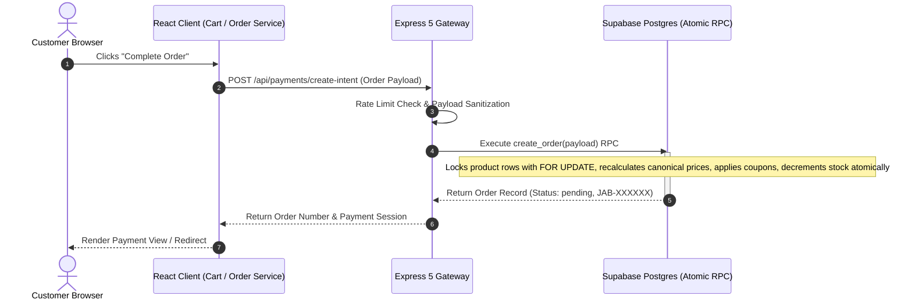

#### B. Payment Webhook Verification & Order Settlement

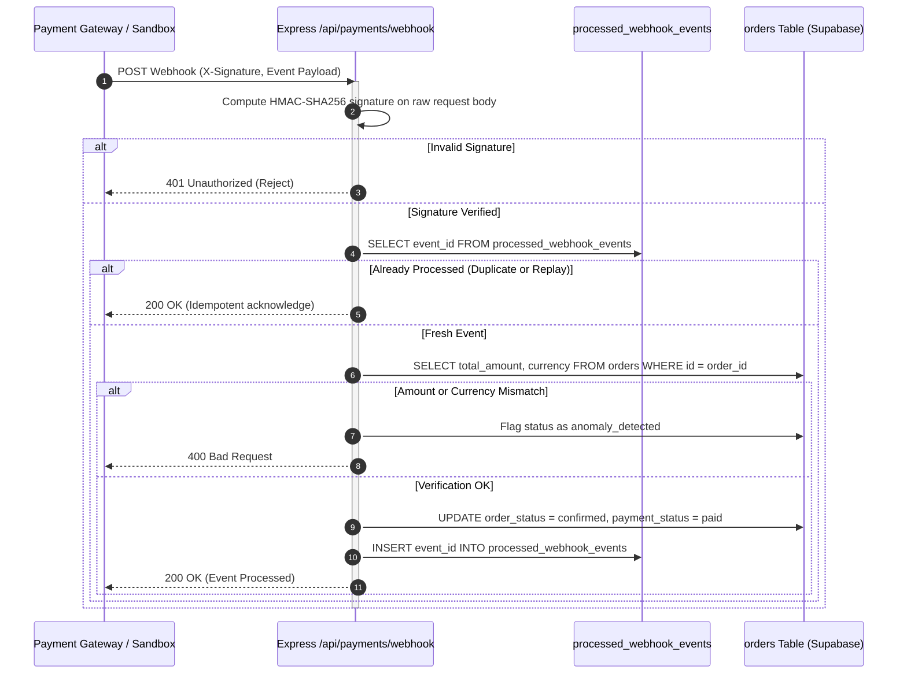

---

### 4. Database Entity-Relationship (ER) Architecture

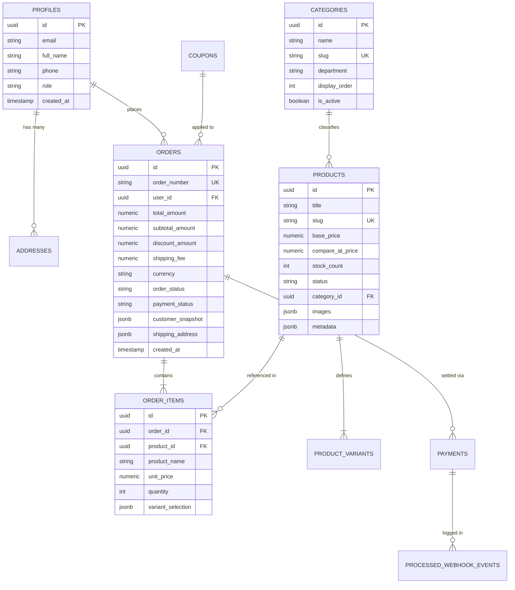

---

### 5. Repository File & Directory Topology

```
JABLEATHER/
├── client/                         # React 19 + Vite 8 Frontend SPA
│   ├── src/
│   │   ├── api/                    # Axios API clients for backend gateway
│   │   ├── components/
│   │   │   ├── admin/              # Shopify-style admin layout and navigation
│   │   │   ├── cart/               # Slide-over cart drawer & authoritative calculations
│   │   │   ├── common/             # Reusable UI primitives (Buttons, Modals, Badges)
│   │   │   ├── home/               # Hero section, brand story, editorial showcases
│   │   │   ├── layout/             # Storefront header, footer, dynamic mega menu
│   │   │   └── product/            # Product cards, filter drawer, responsive grids
│   │   ├── context/                # Auth, Cart, Currency, Wishlist, UI, and Toast providers
│   │   ├── data/                   # High-fidelity baseline catalog fallback datasets
│   │   ├── pages/
│   │   │   ├── admin/              # 20 admin operations screens (Dashboard, Catalog, Orders)
│   │   │   ├── customer/           # Customer account portal (Profile, Orders, Addresses)
│   │   │   └── storefront/         # Catalog, PDP, checkout, about, contact pages
│   │   ├── services/               # Modular service layer with Supabase integration
│   │   └── utils/                  # Currency formatting, validation, and Supabase client
│   └── package.json
├── server/                         # Node.js 20+ + Express 5 Backend Engine
│   ├── catalog/                    # Server-side catalog and inventory validation
│   │   └── catalogRoutes.js        # Catalog inspection and stock verification
│   ├── payments/                   # Provider-agnostic payment gateway layer
│   │   ├── paymentProvider.js      # Unified PaymentProvider abstract interface
│   │   ├── manualProvider.js       # Bank wire / COD manual confirmation provider
│   │   ├── sandboxProvider.js      # Test provider with HMAC webhook generation
│   │   ├── paymentRoutes.js        # Intent creation and HMAC webhook routes
│   │   └── index.js                # Provider factory registry
│   ├── test/                       # Server-side test suites (Node native test runner)
│   ├── server.js                   # Express 5 server with Helmet, rate-limit, and CORS
│   └── package.json
├── docs/                           # Architecture guides and media assets
│   ├── screenshots/                # High-resolution screenshots of the platform
│   ├── DEV_SETUP.md                # In-depth setup walkthrough
│   └── PAYMENTS.md                 # Payment provider integration guide
├── e2e/                            # Playwright End-to-End browser test suite
├── supabase/                       # PostgreSQL migrations & database schema definitions
│   └── migrations/                 # Ordered SQL migrations (RLS, schema, RPC functions)
└── package.json                    # Workspace root scripts
```

---

## 🔒 Security & Data Protection

### 1. Zero Trust Identity Architecture
- **Supabase Auth**: All users are authenticated using Supabase Auth (email and password with session tokens).
- **Strict Role-Based Access Control (RBAC)**: Administrative access is governed strictly by `app_metadata.role === 'admin'`. The system never relies on mutable `user_metadata`.
- **Protected Route Guards**: Customer sessions can never access `/admin/*` routes. Unauthenticated visitors are cleanly redirected without content flashes.

### 2. Row Level Security (RLS)
PostgreSQL Row Level Security policies protect data directly at the database engine layer:

| Table | Public Access | Authenticated Customer | Administrator (`role = 'admin'`) |
| :--- | :--- | :--- | :--- |
| `products` | `SELECT` (active only) | `SELECT` (active only) | `ALL` (create, update, delete, drafts) |
| `categories` | `SELECT` (active only) | `SELECT` (active only) | `ALL` (full CRUD & reordering) |
| `orders` | None | `SELECT` (own user_id only) | `ALL` (read all, update statuses) |
| `profiles` / `addresses` | None | `ALL` (own user_id only) | `ALL` |
| `coupons` | None (validated via RPC) | None (validated via RPC) | `ALL` |
| `store_settings` | `SELECT` (public configs) | `SELECT` (public configs) | `ALL` |

### 3. Payment Integrity & Idempotency
- **Provider-Agnostic Interface**: Clean abstraction supporting Manual Wire/COD, Sandbox test provider, and production gateways (Stripe/PayPal).
- **Authoritative Server Validation**: Order prices are never trusted from the client. Totals are recalculated server-side from database inventory records.
- **HMAC Webhook Signatures**: Inbound payment webhooks verify cryptographic signatures and record unique IDs in `processed_webhook_events` to prevent duplicate execution or replay attacks.
- **Amount & Currency Parity**: Webhooks mark orders as `paid` only if the paid amount and currency match the order record exactly, immediately flagging mismatches.

---

## 🚀 Developer Quickstart

### Prerequisites
- **Node.js**: `v20.x` or higher recommended
- **npm**: `v10.x` or higher
- **Supabase Account**: A free Supabase project for PostgreSQL and Auth

### 1. Repository Setup
```bash
git clone https://github.com/your-username/JABLEATHER.git
cd JABLEATHER
npm install
```

### 2. Configure Environment Variables

Create environment configurations for both client and server:

**Server Configuration (`server/.env`):**
```ini
PORT=5000
CORS_ORIGIN=http://localhost:5173
JWT_SECRET=your_super_secret_jwt_key
SUPABASE_URL=https://your-project.supabase.co
SUPABASE_ANON_KEY=your_supabase_anon_key
SUPABASE_SERVICE_ROLE_KEY=your_supabase_service_role_key
PAYMENT_WEBHOOK_SECRET=your_payment_webhook_secret
```

**Client Configuration (`client/.env.local`):**
```ini
VITE_API_URL=http://localhost:5000
VITE_SUPABASE_URL=https://your-project.supabase.co
VITE_SUPABASE_ANON_KEY=your_supabase_anon_key
```

> [!IMPORTANT]
> Never commit `.env` or `.env.local` files to version control. The repository `.gitignore` is strictly tuned to ignore all environment files across all subdirectories.

### 3. Running Development Servers
Run the fullstack platform locally:
```bash
# Terminal 1: Start Client (Frontend)
npm run dev:client
# Storefront opens at http://localhost:5173

# Terminal 2: Start Server (Backend)
npm run dev:server
# Server listens at http://localhost:5000 (Health check at http://localhost:5000/api/health)
```

---

## 🧪 Testing Suite

The repository features comprehensive automated test suites spanning unit, integration, and browser end-to-end testing:

```bash
# Run all unit and integration tests across client and server
npm test

# Run fast client-side tests with Vitest
npm --prefix client test

# Run backend payments, security, and RLS validation tests
npm --prefix server test

# Run high-performance Oxlint code analysis
npm --prefix client run lint

# Run Playwright End-to-End browser tests
npm run test:e2e
```

### Automated Test Coverage Highlights
- **Cart Mechanics**: Verifies immutable quantity updates, duplicate item merging, stock capping, and price sync.
- **Financial Calculations**: Tests subtotal, coupon discounts, shipping threshold logic, and tax across USD and PKR.
- **Coupon Engine**: Validates expiration dates, minimum spend thresholds, usage limits, and RPC constraints.
- **Order Integrity**: Confirms server-side tampering prevention, inactive product rejection, and atomic stock decrements.
- **Payment Verification**: Tests webhook HMAC signature validation, idempotency guards, and currency mismatch traps.
- **RLS Verification**: Tests customer isolation (Customer A cannot access Customer B's records; anonymous access blocked).

---

## 📸 Automated Screenshot Capture

To regenerate the documentation screenshot assets in `docs/screenshots/`:
```bash
# Ensure both client (5173) and server (5000) are running
node scripts/capture-screenshots.js
```
The script uses headless Chromium to capture crisp, HiDPI Retina screenshots of all key storefront pages, the mobile view, and the authenticated Shopify-style admin screens.

---

## 📜 License & Credits

- **Craftsmanship & Production**: Handcrafted at the JAB LEATHER Atelier in Sialkot, Pakistan.
- **Engineering**: Designed and developed with modern open-source web standards.
- **License**: MIT License. See [LICENSE](LICENSE) for details.
